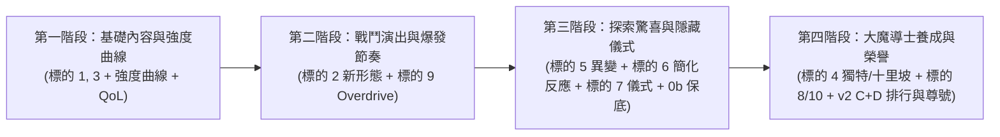

# 《無限魔導書》魔法系統深度拓展：雙報告整合分析與落地總綱

- **整理日期**：2026-10-25
- **整合來源**：
  1. 原先內部設計與代碼架構分析：[`docs/superpowers/specs/2026-10-25-spell-depth-expansion-design.md`](2026-10-25-spell-depth-expansion-design.md)（含第 1～10 節原始構想與第 11 節架構／防作弊深度拆解）
  2. 外部 AI 獨立評估報告：[`網頁掛機遊戲魔法系統擴充分析與建議.md`](../../../網頁掛機遊戲魔法系統擴充分析與建議.md)
  3. 強度曲線基準文件：[`docs/superpowers/specs/2026-10-24-spell-tier-balance-notes.md`](2026-10-24-spell-tier-balance-notes.md)

---

## 一、雙報告整合總結論：高度共識與互補亮點

將兩份報告交叉比對後，雙方在**核心哲學、系統風險診斷、以及架構邊界**上達成了高度一致，同時外部報告也在「異變詞綴分級」與「階段性排程」上提供了極佳的互補視角。

### 1. 最高指導原則（Golden Rule）
> **「保留能力的幻想，限制能力的收益；保留突破規則的演出，不讓它破壞遊戲的成長規則。」**

- **創意零刪減**：「中二感」、禁忌儀式、超位魔法、雙刀流、十里坡劍神等設定非常契合中古世紀魔導書題材，能帶來強烈的世界觀沉浸感與養成浪漫，**所有點子皆予以保留**。
- **把關兩條核心紅線**：
  1. **數值平衡紅線（Balance）**：必須服從「一般魔法 Lv.1～9、稀有禁咒 Lv.10」、「每高一階約 1.5～2 倍 DPS、強化滿 ≈ 高一階剛合成」、「純屬性路線通關時間 60～240 分鐘（`tests/sim/pure-paths.test.ts`）」。任何特殊能力都不能強到讓玩家覺得「不需要再去探索配方或合成高階魔法」。
  2. **防作弊與權限紅線（Anti-Cheat & Server Authority）**：客戶端每 50ms 演算戰鬥（`combat.ts`）、每 60 秒才上傳存檔並由 `audit.ts` 進行錨點時間窗收益稽核。因此，**伺服器看不見客戶端的瞬時戰場狀態、不信任客戶端本地累加的施法次數、也不允許客戶端自行產生額外元素掉落或升階暴擊**。凡涉及隨機覺醒、熟練度里程碑、額外資源／材料減免、階級突破，一律必須由 **伺服器端動作（Server Action）** 判定並同步更新防作弊錨點。

---

## 二、十大構想：原分析 vs 外部報告 交叉整合總表

| 編號與項目 | 原分析診斷（代碼／防作弊視角） | 外部報告建議（體驗／驗收視角） | 最終整合定案與落地方式 | 排程階段 |
| :--- | :--- | :--- | :--- | :--- |
| **1. 魔法命名魔導書化 ＋ 補齊 Lv.1～10** | 🟢 零風險、核心必做；解決 Lv.6/8/9 斷層與現有名稱太像日常自然現象的問題。 | 🟢 優先實作；內容擴充不必靠數值膨脹，以命名與背景建立各階辨識度。 | **直接定案執行**：確立六大魔導位階、替換 10 個舊名稱、補齊 Lv.1～9 各屬性魔法池。 | **Phase 1** （基礎與曲線） |
| **2. 新增施法形態（`beam`, `orbit`, `sigil`, `detonate`）** | 🟢 高價值；在 `combat.ts` 與 `battle-view.ts` 以幾何粒子實作，遵守 `MAX_ACTIVE_FX = 24`。 | 🟢 優先實作；建議**先做較易控制的 `beam`、`sigil`**，再評估 `orbit`、`detonate`，並納入 DPS 與對王模擬。 | **分批實作**：先實裝 `beam`（貫穿光束）與 `sigil`（延時符文陣），次波實裝 `orbit`（環繞星體）與 `detonate`（狀態引爆）。 | **Phase 1～2** （戰鬥表現） |
| **3. 術式學派 `school`、詠唱詞與公開數值／對王補正** | 🟢 解決痛點；公開面板零風險，對單／破防補正可解決多段魔法打高防魔王刮痧的問題。 | 🟢 優先實作；公開數值可減少困惑，但對 Boss 補正必須以實戰模擬數據驗證，不可憑直覺加倍率。 | **數據驅動實作**：先加上 `school`、`chant` 與公開面板；跑出真實戰鬥 DPS 表後，針對刮痧的多段／範圍魔法設計破防或對單補正。 | **Phase 1** （基礎與曲線） |
| **9. 超位魔法解放（Overdrive）** | 🟢 輕量化即可行；固定每第 N 次施法觸發屬於 100% 確定性機制，不影響 `audit.ts`。 | 🟢 優先實作（三大亮點之一）；採確定性充能（每 8 或 10 次施法），將爆發折算進長期平均 DPS 預算。 | **確定性爆發**：每第 10 次施法自動昇華為「✦ 超位詠唱 ✦」（法陣放大、彈道／範圍強化），平均 DPS 納入該階級基準調平。 | **Phase 2** （戰鬥表現） |
| **5. 隨機異變詞綴（Spell Mutations）** | 🟡 原擔心低階洗出 2～3 倍傷害會輾壓高階，建議僅限 Lv.10 禁咒可洗。 | 🟡 **互補新視角**：將異變拆為**「視覺、機制、數值」三類**；只要限制數值上限，低階魔法也能有稀有視覺／微幅異變供收集。 | **採三層分級制**：重複合成時可觸發異變（存於伺服器 `spellMutations`）——Lv.1～9 以「視覺異變（改色／粒子）」與微幅機制（±10% 內）為主；Lv.10 解鎖完整終局詞綴。 | **Phase 3** （探索變化） |
| **6. 元素共鳴反應與束縛契約** | 🔴 單槽自動戰鬥無法手動切招連鎖，複雜反應只會變雙屬性隱藏倍率；建議等「副迴路槽」。 | 🟡 簡化後實作；先做直覺反應（濕潤雷增傷、冰凍易傷、燃燒死亡有限傳染），複雜組合等副迴路槽。 | **兩步走策略**：現階段維持並微調直覺型單步狀態反應；跨魔法元素共鳴留待「待辦 0d 雙重詠唱／副迴路槽」實裝時連動。 | **Phase 3** （探索變化） |
| **7. 禁忌殘頁、儀式合成與點金術** | 🔴 伺服器看不見瞬時戰場（有無王／暈眩），客戶端額外掉落會被 `audit.ts` 判作弊；提出改用伺服器已知狀態與合成退還。 | 🟡 **三大亮點之一，分開處理**：完全認同改用伺服器可驗條件；建議將「儀式合成（探索）」與「點金術（伺服器資源返還）」拆開。 | **拆分並伺服器化**： ① **禁忌儀式**：以 `state.equipped`、`state.currentZone` 或「兩個 `bad` 失敗魔法融合（負負得正）」觸發隱藏古魔法。 ② **點金／減免**：改在伺服器合成 Action 中退還／減免材料並更新錨點。 | **Phase 3** （探索變化） |
| **4. 獨特技能（5%～10%）vs 十里坡劍神（後天極意）** | 🟡 200%～450% 倍率會毀掉階級曲線；本地施法計數可偽造且撞 `audit.ts`；提出改為「改機制不改總 DPS 天花板」與「綁定伺服器 `synthesisLog`／`empower`」。 | 🟡 **三大亮點之一，保留概念重做數值**：獎勵應為專屬形態、視覺蛻變、稱號與有限越級（不可讓 Lv.1 直接取代 Lv.10）；獨特技能總 DPS 控制在 110%～120%。 | **伺服器里程碑＋形態蛻變**： ① **獨特技能**：改為流派機制變化（如雙刀流拆為左右各 55%～60%，總 DPS 110%～120%）。 ② **十里坡劍神**：以伺服器 `empower` 達上限或 `synthesisLog` 累積（結合待辦 0b 保底）解鎖專屬極意名稱、視覺蛻變與有限破防，不取代高階合成。 | **Phase 4** （長期養成） *註：保底可先做* |
| **8. 本命魔導具（Arcane Focus）** | 🟡 快慢輕重與 `school` 重疊；黑書 `tier + 1` 會破壞傷害門檻與越級遞減。 | 🔵 延後或轉型；初期做外觀、收藏與 ±10% 手感微調，**絕不直接修改魔法 `tier`**。 | **延後並轉型**：移除 `tier + 1`；留待後期作為擊敗魔王的收藏品（改變小人手持武器／法陣外觀＋±10% 手感微調）。 | **Phase 4 / v3** （長期養成） |
| **10. 元素靈光與動態魔導尊號** | 🔴 常駐傷害靈光干擾 DPS 量測與特效上限；動態尊號與 v2 C+D 稱號同源。 | 🔵 拆開處理；靈光先做純視覺效果（視覺與數值分離），動態尊號併入 v2 C+D 稱號系統。 | **拆開實裝**：元素靈光作為純屬性專精的「純視覺環繞粒子（無傷害）」；動態尊號直接併入第二版 C+D 排行榜與稱號系統。 | **v2 C+D / Phase 4** |

---

## 三、重點機制的「最終整合設計方案」（精華細節）

結合兩份報告的優點，針對最核心也最複雜的三個「破格／中二」系統，確立以下安全且好玩的實作規格：

### 1. 【獨特技能 vs 十里坡劍神】如何兼顧「爽感、平衡、防作弊」？
- **天賦軌（先天獨特技能）——「視覺與機制破格，數值守恆」**：
  - **《並聯詠唱（雙刀流）》**：施法時左右雙法陣齊發，主魔法與同屬性次高階魔法同時射出，但各自基礎傷害調整為 **55%～60%**（總期望 DPS 為 **110%～120%**，打擊段數與滿螢幕視覺爽感翻倍，卻不會跨階秒王）。
  - **《大賢者》／《黃金律》**：不在客戶端打怪時偷加掉落，而是「合成台顯示未知配方數量提示」＋「在伺服器合成／升階 Action 時，有 15% 機率由伺服器減免部分材料並同步更新 `audit.ts` 錨點」。
  - **《無詠唱》／《爆裂偏執狂》**：透過冷卻與單發傷害的對價交換（例如冷卻 ×2、單發傷害 ×2.2、範圍擴大），使長期平均 DPS 嚴格落在 **110%～120%** 預算內。
- **努力軌（十里坡劍神／後天極意）——「伺服器權威里程碑 ＋ 返璞歸真蛻變」**：
  - **廢除「客戶端本地施放次數上傳」**（防偽造、防 `audit.ts` 拒絕）。
  - **改用三個 100% 伺服器權威的努力指標**：
    1. **【百敗成聖（結合待辦 0b 稀有落空保底）】**：根據伺服器 `synthesisLog` 記錄的落空／重複次數，累積「魔導底蘊」，逐步提高機率配方的成功率（保底機制）並給予全魔法小幅基礎加成。
    2. **【萬法歸宗・極意進化】**：當玩家將任一低中階魔法（如 Lv.1《魔力彈》或 Lv.2《火球》）透過伺服器 `empower` 強化至滿級（如 `+50`），且未持有先天獨特技能時，可消耗特殊魔王素材解鎖該魔法的**「極意型態」**（改名為《極意・弒神魔彈》、施法特效進化為金色符文光束、獲得額外防禦穿透，使其能作為跨一階的實用戰力或未來「副迴路槽」的頂級核心，但不會直接等同 Lv.10 禁咒而廢掉後續合成）。

### 2. 【随机異變詞綴（Spell Mutations）】的三層分級設計
採納外部報告建議，打破「只有 Lv.10 能異變」的限制，讓重複合成（`duplicate`）從前期就有驚喜：
1. **第一層：視覺異變（Visual Mutation，Lv.1～10 皆可出現，零平衡風險）**
   - 例如：`【蒼炎之】`（火系粒子轉為幽藍色）、`【星輝之】`（飛彈拖尾附帶十字星芒）、`【古符之】`（擴散波紋附帶旋轉符文圈）。
2. **第二層：手感／微機制異變（Mechanic Mutation，Lv.4+ 可出現，DPS 影響 ≤ ±5%）**
   - 例如：`【引力之】`（微幅牽引）、`【震盪之】`（擊退距離小幅增加）、`【極速彈道之】`（飛行速度 +30%，不改冷卻）。
3. **第三層：終局數值異變（Endgame Mutation，僅限 Lv.10 神話禁咒）**
   - 因為 Lv.10 已無更高階魔法可被越級，允許在終局洗出較鮮明的詞綴（如彈道 +1、領域時間延長、破甲提升），作為通关後的長線追求。

### 3. 【禁忌殘頁與儀式合成】的伺服器安全實作
將原本「看戰場上有沒有活著的魔王」改為**伺服器在 `POST /api/action`（synthesize）當下 100% 能夠驗證的三大儀式條件**：
1. **【負負得正・混沌逆轉儀式】**：將兩個 `affinity === 'bad'` 的失敗作魔法（如《沸霧逆流》＋《地脈噬雷》）放上合成台融合，觸發夾頁揭曉動畫，合出隱藏古魔法。
2. **【地脈共鳴儀式（Zone-Bound Ritual）】**：玩家當前所在區域 `state.currentZone` 必須位於指定高階地圖（如「沉沒神殿」），在該地脈環境下進行特定配方合成，才能喚醒失落古魔法。
3. **【以身飼魔儀式（Equipped-Bound Ritual）】**：玩家合成當下身上正裝備（`state.equipped`）帶有反噬特性的魔法（如《魔力過載》），以此作為媒介觸發禁忌配方。

---

## 四、整合後的四階段開發路線圖（Roadmap）

將上述十項設計與您原本排定的待辦事項（強度曲線、QoL 小功能、v2 C+D 排行榜）完美縫合，建議按以下四個階段推進：

### 📌 第一階段（目前立即執行）：基礎內容、Lv.1～10 擴充與階級強度曲線
1. **魔法內容定案（標的 1、標的三）**：
   - 確立 Lv.1～10 魔導位階稱呼、現有 10 招魔法改名、新增魔法補齊 Lv.1～9 各階空缺（稀有魔法固定 Lv.10）。
   - 為所有魔法加上 `school`（術式學派）、高階 `chant`（詠唱古語），並在 `NodeCard`／`Notebook` 公開攻擊力、冷卻秒數與狀態持續時間。
2. **DPS 量測與階級強度曲線重塑（待辦 1）**：
   - 撰寫模擬量測腳本（先清一波小怪、再打魔王），檢視所有魔法在 +0 與強化滿的實際 DPS。
   - 針對多段／範圍魔法打高防 Boss 刮痧問題，加入經數據驗證的破防／對單補正，確保符合「高一階 1.5～2 倍 DPS、同階同水準、純屬通關 60～240 分鐘」。
3. **順手完成的 QoL 小功能（待辦 1、1c）**：
   - 戰鬥畫面顯示「距離魔王出現還差幾隻」、合成台記住上一次的選擇、學會新魔法時跳出 3 秒裝備詢問通知（稀有魔法揭曉後等待選擇）。

### 📌 第二階段：強化戰鬥視覺與爆發高潮
1. **新增標誌性施法形態（標的二）**：優先實裝 `beam`（貫穿光束）與 `sigil`（延時符文陣），並視情況加入 `orbit`／`detonate`，全部通過 DPS 模擬把關。
2. **超位魔法解放 Overdrive（標的九）**：實裝每第 10 次施法確定性觸發的「✦ 超位詠唱 ✦」演出與爆發效果（平均 DPS 控制在該階級預算內）。

### 📌 第三階段：增加合成探索變化與保底機制
1. **稀有落空保底／百敗成聖（待辦 1b ＋ 標的四之努力機制）**：利用伺服器 `synthesisLog` 實裝落空累積補償／保底提升。
2. **三層分級異變詞綴（標的五）**：重複合成時可洗出視覺異變、微機制異變或 Lv.10 終局詞綴。
3. **禁忌儀式合成（標的七）** 與 **直覺元素反應微調（標的六）**。

### 📌 第四階段：長期養成、榮譽展示與沉浸感擴充
1. **第二版 C+D：排行榜、每日至尊稱號與動態魔導尊號（標的十）**。
2. **先天獨特技能 vs 十里坡極意進化（標的四）**、**純視覺元素靈光（標的十）**、**本命魔導具外觀與微調（標的八）**，以及 **待辦 0d 之副迴路共鳴槽與大魔法師高塔手札／火漆信件**。

---

## 五、實作驗收的七大鐵律（Checklist）

未來每完成上述任何一個階段，都必須通過以下 7 項自動化與體驗檢查：

1. **階級曲線檢查**：每高一階是否維持 1.5～2 倍 DPS？強化滿是否約等於高一階剛合成？
2. **模擬通關時間**：`tests/sim/pure-paths.test.ts` 五大純屬性與混合路線是否全數落在 60～240 模擬分鐘、且 **0 次被伺服器拒絕**？
3. **跨情境表現**：多段／範圍魔法對成群小怪與高防禦 Boss 是否皆有合理表現（不刮痧、不秒王）？
4. **核心循環保護**：新機制是否保留了「探索未知配方、合成更高階魔法」的核心驅動力？
5. **伺服器權威與防作弊**：所有合成、隨機異變、覺醒、保底里程碑與材料返還是否皆在伺服器端決定並同步更新 `audit.ts` 錨點？
6. **測試可重現性**：固定亂數種子（Seed）下，Overdrive 與各形態的戰鬥模擬結果是否 100% 可重現？
7. **視覺與數值分離**：純視覺異變、元素靈光、幾何法陣演出是否確保零額外傷害、且不突破 `MAX_ACTIVE_FX = 24`？
